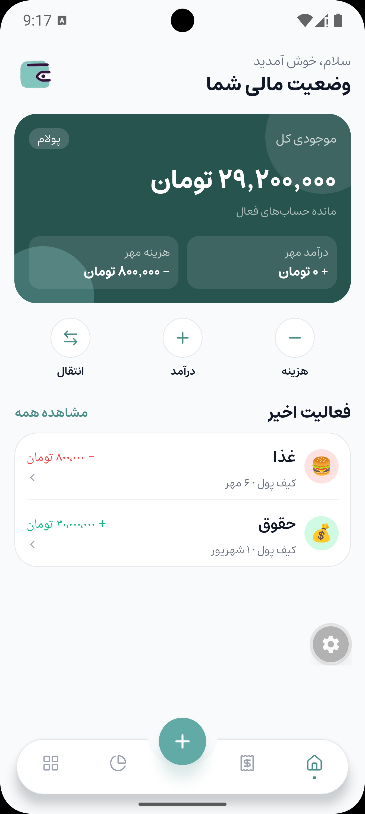
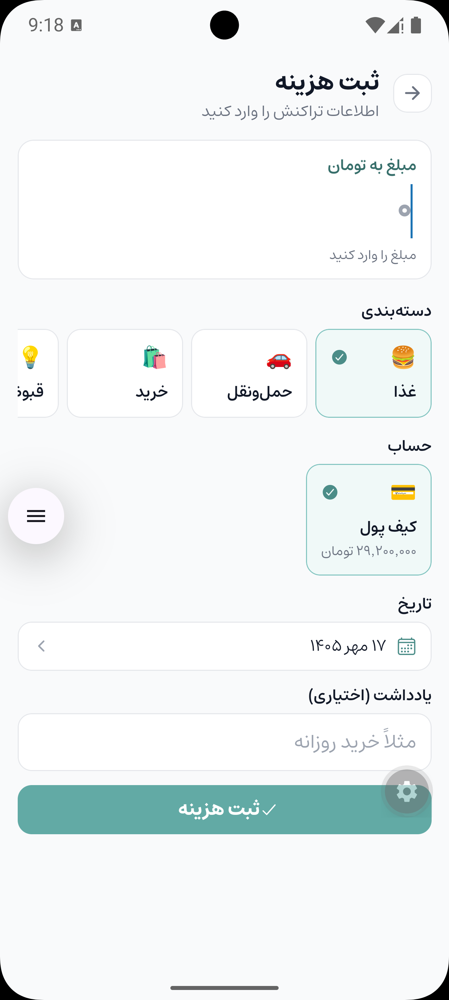
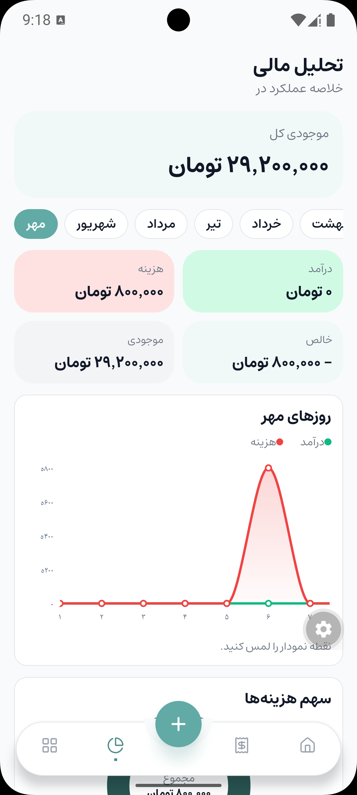
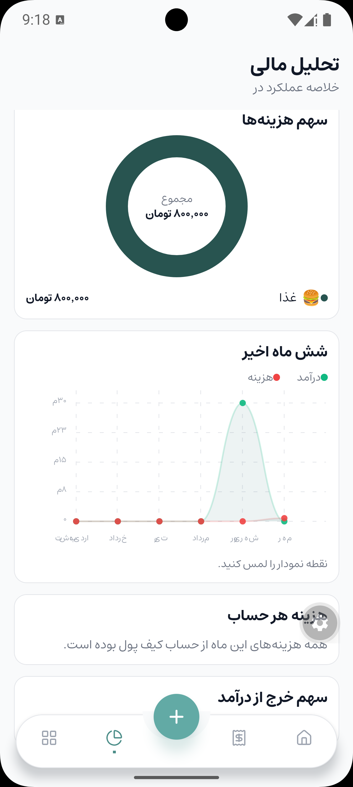
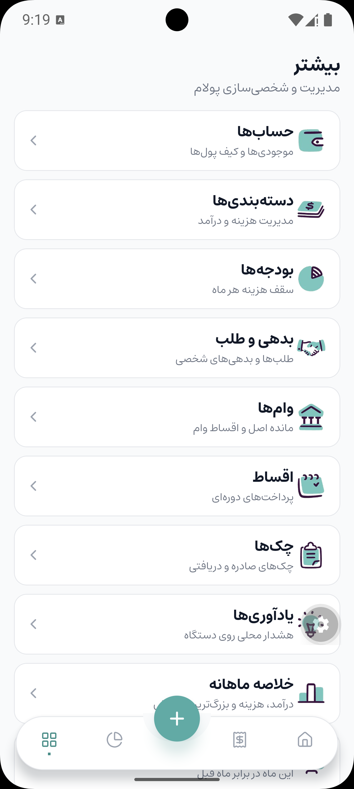
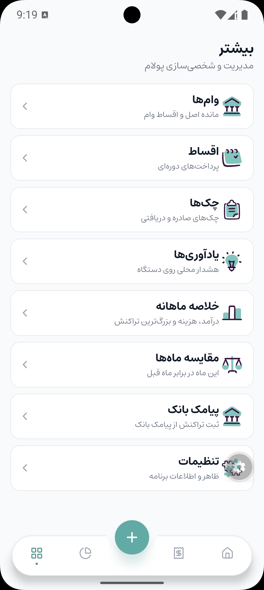

# پولام

Polam is an offline personal-finance app for Persian-speaking users. Balances, transactions, and the rest of the books stay in a SQLite database on the device. There is no account and no server.

The interface is right-to-left. Dates use the Persian calendar, and amounts are stored in rial and shown in toman.

## Features

- See the total balance of active accounts
- See this month’s income and expenses on the home screen
- Review recent activity, then open the full transaction list
- Record an expense, an income, or a transfer between accounts
- Pick a category, account, Persian date, and optional note for each entry
- Search transactions and browse them by day
- Open a transaction to review it
- Manage multiple accounts and wallets
- Manage expense and income categories
- Set a monthly spending budget
- Track money you owe and money owed to you
- Track loans, remaining principal, and loan installments
- Track recurring installment payments
- Track issued and received checks
- Schedule a reminder that fires as a local notification
- Open a monthly summary of income, expenses, and the largest transaction
- Compare this month with the previous month
- Switch the analytics view between Persian months
- See that month’s balance, income, expense, and net
- See daily income and expense on a chart
- See each category’s share of spending
- See income and expense across the last six months
- See this month’s spending by account
- On an Android build, map a bank SMS sender to an account and turn deposit or withdrawal messages into transactions
- Keep messages the parser cannot read in a review list
- Switch between light, dark, and the device theme

## Screenshots

| Home | Record an expense | Analytics |
| :---: | :---: | :---: |
|  |  |  |

| Expense share | More | More, continued |
| :---: | :---: | :---: |
|  |  |  |

## Stack

Expo, React Native, TypeScript, NativeWind, and SQLite. Bank SMS uses a local Android module, `modules/polam-sms`, so that flow needs a native build rather than Expo Go.

## Run

```bash
npm install
npx expo start
```

Android, including bank SMS:

```bash
npx expo run:android
```
